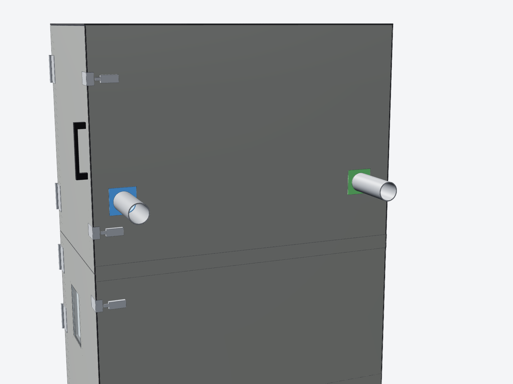
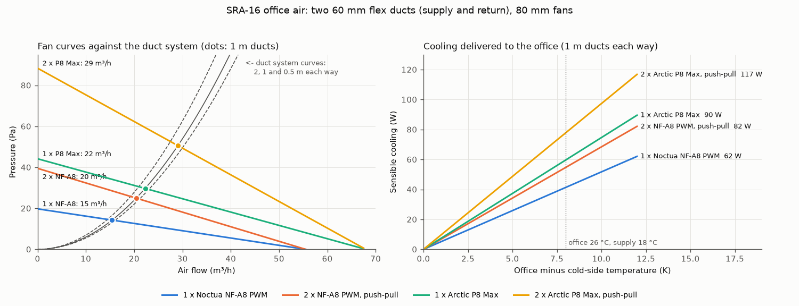

# Office air: cold air from the rack to the office next door

Two 60 mm flexible ducts run from the cabinet's right-hand side, straight through the office wall:

- **Supply** (blue flange): from the front **cold** bay, with an 80 mm PWM fan inside the sleeve. It blows AC-cooled air into the office.
- **Return** (green flange): an equal duct with no fan, from the office back into the rear **hot** bay. The AC's evaporator draws from there.

**Why there are two ducts.** The cabinet is a sealed loop. If air only went out, the cabinet would draw unfiltered, humid room air in through every gap, and the AC would end up cooling the house. With a return, the office joins the loop. The office air that comes back is a little warmer than the cold side, so the AC simply sees a slightly warmer return.

## What to expect (honest numbers)

`tools/office_air.py` adds up the losses through the circuit: grilles, fan outlet, spigots, 60 mm flex duct and the wall grilles. Each loss uses a coefficient from Idelchik's handbook. The fan curves are derated 15% for the flex duct and the grilles. With a 1 m duct each way, the coefficients total K ≈ 10.3:

| Fan (in the supply sleeve) | Air (m³/h) | Cooling at 8 K difference | Drying (26 °C, 55% RH office) | Noise |
|---|---|---|---|---|
| **1 × Noctua NF-A8 PWM** (standard) | 15.4 | **41 W** | 46 W, 1.6 L/day | 17.7 dB(A) flat out, inaudible in the cabinet |
| 2 × NF-A8, push-pull (2nd fan in the return sleeve) | 20.4 | 55 W | 61 W, 2.1 L/day | about 21 dB(A) |
| 1 × Arctic P8 Max | 22.3 | 60 W | 67 W, 2.3 L/day | audible above about 3000 rpm |
| 2 × P8 Max, push-pull | 29.1 | **78 W** | 87 W, 3.1 L/day | audible; cap it with *Office fan maximum* |

Duct length matters little at this size. Going from 0.5 m to 2 m costs about 10%; the grilles and the duct bore set the flow.

**What this means in the room:**

- 40-80 W of sensible cooling plus roughly the same again in drying. That takes the edge off a small office. It **does not replace a split system.** For comparison, a person gives off about 100 W and a laptop and monitor about 60 W.
- In the thermal simulation (an office with 120 W of gains and a 27 °C day, 30 °C when uncooled), the NF-A8 brings the office about **1.4 K** cooler. Two P8 Max fans bring it about **2.4 K** cooler.
- **If you want more:** use bigger ducts, not stronger fans. Flow scales with the duct area. A 100 mm duct pair with 120 mm fans would carry about 3 times the air, around 200 W. The sleeve, flange and skin hole are all driven by `office_duct_d` and `office_fan` in `rack_layout.py`, so this is a parameter change and regeneration. The AC has headroom: 4 kW nominal against a 2-2.5 kW design load.

## Rack first

The servers always come first. The controller blocks the office fan, and stops it at once, whenever any of these is true:

- the cold side is more than 1.5 K above its target (released at 0.5 K);
- any rack alarm is active: cold warning or critical, hot warning, leak, sensor fault, condensation or no AC power;
- the AC is not cooling, a shutdown is requested, or the AC mode is Off.

The screen shows **Rack first** while the fan is held off. The simulation includes a case with the AC losing 40% of its capacity. In it, the fan stops whenever the rack runs warm and resumes when it recovers.

## Controls

| Setting (Home Assistant, via the touchscreen; mode and target also on its *Settings* tab) | Default | What it does |
|---|---|---|
| Office air | Auto (when the kit is fitted) | Off / Auto / On. On runs the fan regardless of the office probe, but rack-first still applies. |
| Office target | 24 °C | Calls above 24.5 °C and is satisfied below 23.5 °C. |
| Office supply air | 18 °C | While the office calls, the cold-side target drops to this, but never below the office dew point + 2 K. The setpoint returns afterwards. |
| Office fan maximum | 100% | Caps the fan speed. Use it with the P8 Max for a quieter maximum. |

- The fan only runs when the cold side is at least 1.5 K colder than the office, so it never blows warm air. It ramps from 30% to max over 2 K of call, and runs and rests for at least 2 minutes each time.
- Eco cycling is paused while the office calls.
- The touchscreen sends the room humidity so the node can keep the office supply above the room's dew point. This stops the office grille from sweating.
- **Alarm `office fan`:** the fan reads under 300 rpm for 60 s while it should be running. Check W9 or the fan.
- Home Assistant gets *Office (T7)*, *Office fan speed*, *Office fan* (%) and *Office air state*.

## Electronics (drawing CP-SRA16-ELC-001 rev B)

- **J11:** a 4-pin PC fan header on the carrier.
  - PWM from GPIO14 through Q3 (open collector, 25 kHz).
  - Tach to GPIO15.
  - F2, a 0.5 A PTC, protects the fan's 12 V.
  - R16 holds the fan off while the ESP32 boots.
  - There is no power switch: both specified fans stop at 0% PWM.
- **T7:** a DS18B20 probe in the office return grille's probe channel, on the hot-side 1-Wire bus (spliced at T5). Put its address in the `t_office` substitution in `sra16-node.yaml`.
- **Cables:** W9 is the fan lead; W10 is the T7 lead.
- **Modbus:** the screen reads 0x14-0x18 and reads/writes 0x26-0x29. It writes room RH to 0x34.

## Parts

| Part | Qty | Material | What |
|---|---|---|---|
| P9 Office port sleeve | 2 | PETG | 86 mm square sleeve through the foam, with a 3 mm end plate. Holds the fan. |
| P10 Office fan grille | 2 | PETG | Finger guard on the cabinet side, 74% open. |
| P11 Office duct spigot | 2 | PETG | 88 mm flange plus a Ø60 spigot with a bead, for your 60 mm duct and clamp. |
| P12 Office wall grille | 2 | PETG | 110 mm square grille plus a 40 mm spigot for the office side, 78% open. It has a T7 probe channel. |
| G3 Duct gauge | 1 | PETG | Check your duct's fit before printing the rest. |
| Noctua NF-A8 PWM | 1 | - | Supply fan, or see the table for options. |
| DS18B20 probe T7 | 1 | - | 3 m lead. |
| M3 × 50 socket head A2 + nyloc + washers | 8 | - | Four per port, through grille, fan, sleeve, skin and flange. |
| Foam tape 2 mm and 3 mm | 1 set | - | Fan gasket, flange gaskets. |
| 60 mm flex duct and hose clamps | 2 runs | - | Owner supplied. |

These lines are all in `bom/BOM.md`, `bom/electronics.csv` and `bom/printed_parts.csv`. The office parts print on plates 13-14. The skin piece **SR3** (sheet-metal pack rev B) has the two Ø56 port holes and 4 × Ø3.4 bolt holes per port. Both ports sit at 1320 mm above the floor:

| Port | From the front of the cabinet (y) |
|---|---|
| Supply | 99 mm |
| Return | 951 mm |

## Installing

1. **Check your duct.** Print G3 first and push your 60 mm flex duct over it with a clamp. If it is loose or tight, adjust `office_duct_d` and regenerate.
2. **Cabinet side.** For each port, build up the stack on the M3 × 50 bolts, from the inside out:
   - grille P10;
   - the fan (supply only), on 2 mm foam, with its airflow arrow pointing **outwards**;
   - sleeve P9 through the foam;
   - the skin;
   - 3 mm foam, then flange P11.

   Tighten the nylocs until the foam just compresses.
3. **Wall.** Mark the two holes level with the ports (1320 mm above the floor).
   - Space them 852 mm apart, matching the ports' centres.
   - Drill them **70-76 mm** with a hole saw so the P12 spigot slides in.
   - In a stud wall, find the studs first: there is about 90 mm between them. Sleeve the cavity with the duct itself.
   - Screw P12 on the office side with wall plugs and 4 mm countersunk screws.
4. **Ducts.** Keep them short and straight, cut to length with a little slack. Clamp them on both spigots.
   - Use **insulated flex duct** for the supply. At 18 °C it will sweat on a humid day if it runs through a warm cavity.
   - Leave **at least 150 mm** between the cabinet's right side and the wall for the duct bends.
5. **Probe.** Clip T7 into the channel at the top of the office return grille's bore. It then reads the office air as it leaves the room.
6. **Wire.**
   - Plug W9 into J11.
   - Splice W10 (T7) onto the hot-side bus at T5.
   - Set `t_office` and `office_fitted: "true"` in the substitutions of `sra16-node.yaml`.
7. **Commission.**
   - Warm T7 in your hand. *Office air* should show Waiting, then **Cooling** once the cold side is 1.5 K colder, and the fan speed should appear.
   - Unplug W9 while it runs. The *office fan* alarm should come up within a minute.

## Sealing and noise

- Each port is a hole through the acoustic lining, so seal it well:
  - the flange gasket closes the skin;
  - the sleeve fills the foam;
  - the MLV is cut to the same Ø56.
- The duct connects the cabinet to the office, so some server noise will come through it. The fan grille, the duct bend and the wall grille each take some off. Expect a faint hiss in a quiet office. Use lined (insulated) flex duct with one gentle bend if this matters.
- When the office kit is **not** fitted, set `office_ports=0` before cutting. The skin then has no holes. If the holes are already cut, plug each port with its sleeve and a blanking plate.
