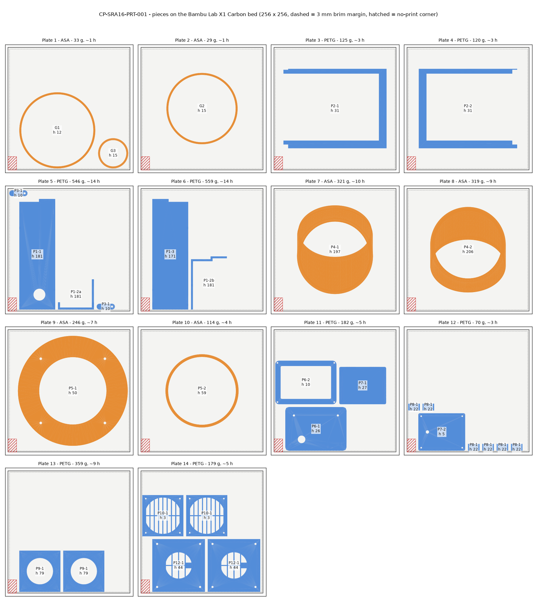
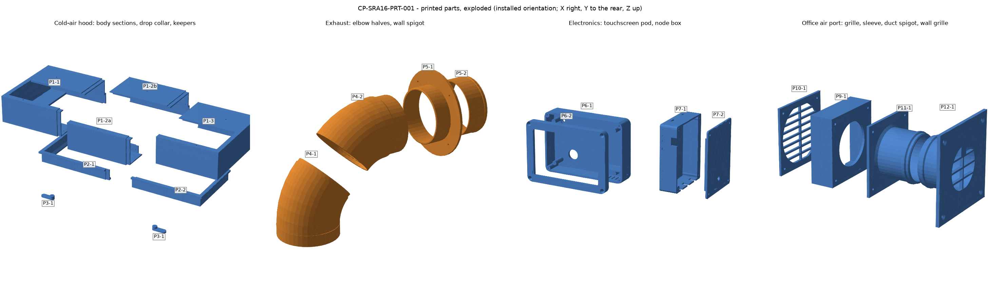

# SRA-16 - 3D-printed parts (CP-SRA16-PRT-001 rev D)

Generated by `tools/make_print_pack.py` from `rack_layout.py` v1.4.0 for the **Bambu Lab X1 Carbon**: 256 x 256 x 256 mm build volume, used as 250 x 250 x 250 so there is room for a brim and some headroom.

Every piece is split to fit, oriented to print **without supports**, and exported as an STL that already sits on the plate. The parts are built from the same model as the rest of the rack, so they follow any parameter change (re-run the tool after the tape checks).

| File | Use |
|---|---|
| `cad/print/stl/*.stl` | one STL per piece, print orientation |
| `cad/print/SRA16_print_x1c.zip` | the STLs + `PRINT_README.txt` (settings and plates) |
| `cad/print/SRA16_printed_parts.step` | every piece in its installed position; open with `SilentRackAC.step` |
| `bom/printed_parts.csv` | piece list with size, mass, time and plate |
| `cad/print/print_report.json` | all checks below |

## What is printed

| Part | Material | Pieces | Replaces | Why print it |
|---|---|---|---|---|
| P1 Cold-air hood body | PETG | P1-1, P1-2a, P1-2b, P1-3 | Cold air hood | The design already allowed a printed hood. Split into end sections and two middle channels. |
| P2 Hood drop collar | PETG | P2-1, P2-2 | Cold air hood | The model shows the drop collar fused to the hood; printed, it is a separate part that slides in the hood floor and rests on the AC top under its own weight. |
| P3 Collar keeper | PETG | P3-1 x2 | - | Turn buttons under the hood floor: lift the collar onto them to roll the AC in or out. |
| P4 Exhaust elbow | ASA | P4-1, P4-2 | Exhaust elbow (insulated) | The socket that fits over the AC spigot and the male outlet are custom; a stock elbow needs adapters. |
| P5 Exhaust wall spigot | ASA | P5-1, P5-2 | Exhaust wall spigot | The flange is drilled to the laser-cut rear-skin pattern; the outer tube carries a hose bead. |
| P13 Hot-return boot | PETG | P13-11, P13-12, P13-21, P13-22 | Hot return boot | Caps the AC's rear return (evaporator) grille and seals it to the hot bay, so the return air is ducted into the AC instead of swirling in the bay. Split into four corners for the bed; the grille size and position are a parametric default - check them with gauge G4 first (see `docs/RACK_PLENUMS.md`). |
| G Fit gauges | ASA | G1, G2, G4, G3 | - | Ten-minute prints that prove the critical fits before the long prints (G3: your office duct; G4: the AC return grille). |
| P6 Touchscreen pod | PETG | P6-1, P6-2 | - | Holds the 4.3 inch touchscreen on the upper door; bolts to two rivnuts and covers the cable grommet (see `docs/ELECTRONICS.md`). |
| P7 Rack node box | PETG | P7-1, P7-2 | - | Holds the rack node's carrier board inside the front plenum, on magnets. |
| P8 Probe clips | PETG | P8-1 x6 | - | Hold the temperature probes (and the humidity sensor's lead) in the air stream, on magnets. |
| P9 Office plenum adaptor | PETG | P9-1 x2 | Office supply adaptor, Office return adaptor | One piece per port: fills the cut in the right side lining, tapers smoothly from the 80 mm fan to the 60 mm duct and carries the duct spigot out through the skin. The fan screws to its inner face; four screws from outside hold it to the skin (see `docs/OFFICE_AIR.md`). |
| P10 Office port grille | PETG | P10-1 x2 | Office supply grille, Office return grille | Finger guard, screwed over the fan (supply) or straight onto the adaptor (return). |
| P12 Office wall grille | PETG | P12-1 x2 | - | Finishes each duct on the office side of the wall; the return one holds the office probe T7. |

The cold side is PETG: it carries 12-18 degC air and copes with condensation. The hot side is ASA: the exhaust runs at up to about 60 degC, which is too close to PETG's softening point. Totals: PETG 28 pieces, about 2.51 kg and 68 h; ASA 8 pieces, about 1.07 kg and 33 h (solid-wall estimate, 0.4 mm nozzle).

## Pieces

| Piece | Qty | Material | Print size X x Y x Z mm | Mass g | Time h | Plate | On the plate |
|---|---:|---|---|---:|---:|---|---|
| P1-1 Hood body - left end | 1 | PETG | 75 x 231 x 181 | 415 | 10.3 | 6 | end wall on the plate, tongue up |
| P1-2a Hood body - middle, front channel | 1 | PETG | 75 x 63 x 181 | 125 | 3.3 | 7 | rebate end on the plate, tongue up |
| P1-2b Hood body - middle, rear channel | 1 | PETG | 75 x 111 x 181 | 158 | 4.1 | 8 | rebate end on the plate, tongue up |
| P1-3 Hood body - right end | 1 | PETG | 75 x 231 x 171 | 402 | 10.0 | 9 | end wall on the plate |
| P2-1 Drop collar - left half | 1 | PETG | 216 x 166 x 31 | 125 | 3.3 | 4 | lip on the plate |
| P2-2 Drop collar - right half | 1 | PETG | 206 x 166 x 31 | 120 | 3.2 | 5 | lip on the plate |
| P3-1 Collar keeper | 2 | PETG | 38 x 12 x 10 | 3 | 0.3 | 7 | arm on the plate, print 2 |
| P4-1 Exhaust elbow - inlet half (socket) | 1 | ASA | 159 x 185 x 197 | 321 | 9.5 | 10 | socket on the plate, tongue up |
| P4-2 Exhaust elbow - outlet half (spigot) | 1 | ASA | 158 x 179 x 206 | 319 | 9.5 | 11 | male spigot on the plate, rebate up |
| P5-1 Wall spigot - flange + inner tube | 1 | ASA | 230 x 230 x 50 | 246 | 7.3 | 12 | flange face (outside) on the plate |
| P5-2 Wall spigot - outer tube | 1 | ASA | 153 x 153 x 59 | 114 | 3.5 | 13 | hose end on the plate, tongue up |
| P13-11 Hot-return boot - lower left corner | 1 | PETG | 140 x 170 x 50 | 97 | 2.6 | 7 | flange face on the plate, mouth up |
| P13-12 Hot-return boot - upper left corner | 1 | PETG | 140 x 160 x 50 | 92 | 2.5 | 9 | flange face on the plate, mouth up |
| P13-21 Hot-return boot - lower right corner | 1 | PETG | 130 x 170 x 50 | 92 | 2.5 | 8 | flange face on the plate, mouth up |
| P13-22 Hot-return boot - upper right corner | 1 | PETG | 130 x 160 x 50 | 87 | 2.4 | 6 | flange face on the plate, mouth up |
| P6-1 Touchscreen pod - shell | 1 | PETG | 128 x 91 x 26 | 79 | 2.2 | 14 | door side on the plate |
| P6-2 Touchscreen pod - bezel | 1 | PETG | 128 x 91 x 10 | 40 | 1.2 | 14 | front face on the plate |
| P7-1 Rack node box - base | 1 | PETG | 98 x 78 x 27 | 62 | 1.8 | 14 | base on the plate |
| P7-2 Rack node box - lid | 1 | PETG | 98 x 78 x 5 | 20 | 0.7 | 15 | outer face on the plate |
| P8-1 Clip - temperature probe | 6 | PETG | 24 x 14 x 22 | 8 | 0.5 | 15 | magnet face on the plate, print 6 |
| P9-1 Office plenum adaptor | 2 | PETG | 86 x 86 x 79 | 179 | 4.6 | 16 | inner (fan) face on the plate, spigot up, print 2 |
| P10-1 Office port grille | 2 | PETG | 86 x 86 x 3 | 13 | 0.6 | 17 | plenum face on the plate, print 2 |
| P12-1 Office wall grille | 2 | PETG | 110 x 110 x 44 | 77 | 2.1 | 17 | room face on the plate, print 2 |
| G1 Gauge - elbow socket over the AC spigot | 1 | ASA | 159 x 159 x 12 | 25 | 1.0 | 1 | print first |
| G2 Gauge - male spigot into the 150 duct | 1 | ASA | 149 x 149 x 15 | 29 | 1.1 | 2 | print first |
| G4 Gauge - hot-return boot corner (check the AC return grille) | 1 | ASA | 110 x 110 x 3 | 13 | 0.6 | 3 | print first (check the grille) |
| G3 Gauge - office flex duct over the spigot | 1 | ASA | 63 x 63 x 15 | 8 | 0.5 | 3 | print first (office kit) |

## Bambu Studio settings

**PETG** - cold side: hood, collar, keepers (water-resistant, tough; carries 12-18 degC air)

| Setting | Value |
|---|---|
| Filament | Bambu PETG HF (or any PETG), dried |
| Nozzle / layer | 0.4 mm / 0.20 mm (0.6 mm / 0.30 mm halves the hood time) |
| Walls | 4 wall loops, 5 top + 5 bottom layers: the 4 mm walls print solid |
| Infill | 15% gyroid (only the thick spots use it) |
| Plate | Textured PEI, no glue |
| Brim | 5 mm on the hood ends and the collar; 8 mm on the two middle channels (tall, narrow) |
| Supports | none - every piece is oriented to print without them |
| Cooling | profile default; open the top glass on a hot day (PETG clogs in a warm chamber) |

**ASA** - hot side: exhaust elbow, wall spigot and their gauges (exhaust air up to about 60 degC)

| Setting | Value |
|---|---|
| Filament | Bambu ASA (or any ASA), dried |
| Nozzle / layer | 0.4 mm / 0.20 mm |
| Walls | 4 wall loops, 5 top + 5 bottom layers |
| Infill | 15% gyroid |
| Plate | Textured PEI + glue stick |
| Brim | 5 mm on everything except the gauges |
| Supports | none |
| Chamber | door and lid closed, chamber warm before starting (warps less) |

Import the STLs as they are: they are already the right way up. Keep the filament's shrinkage compensation at its default and use the gauges (below) to confirm the fits.

## Plates

| Plate | Material | Pieces | Tallest mm | Mass g | Time h |
|---:|---|---|---:|---:|---:|
| 1 | ASA | G1 | 12 | 25 | 1.0 |
| 2 | ASA | G2 | 15 | 29 | 1.1 |
| 3 | ASA | G4, G3 | 15 | 21 | 1.1 |
| 4 | PETG | P2-1 | 31 | 125 | 3.3 |
| 5 | PETG | P2-2 | 31 | 120 | 3.2 |
| 6 | PETG | P13-22, P1-1 | 181 | 503 | 12.7 |
| 7 | PETG | P13-11, P1-2a, P3-1, P3-1 | 181 | 228 | 6.5 |
| 8 | PETG | P13-21, P1-2b | 181 | 250 | 6.6 |
| 9 | PETG | P13-12, P1-3 | 171 | 494 | 12.5 |
| 10 | ASA | P4-1 | 197 | 321 | 9.5 |
| 11 | ASA | P4-2 | 206 | 319 | 9.5 |
| 12 | ASA | P5-1 | 50 | 246 | 7.3 |
| 13 | ASA | P5-2 | 59 | 114 | 3.5 |
| 14 | PETG | P6-1, P6-2, P7-1 | 27 | 182 | 5.2 |
| 15 | PETG | P7-2, P8-1, P8-1, P8-1, P8-1, P8-1, P8-1 | 22 | 70 | 3.4 |
| 16 | PETG | P9-1, P9-1 | 79 | 359 | 9.2 |
| 17 | PETG | P12-1, P12-1, P10-1, P10-1 | 44 | 179 | 5.4 |

## Print order

Plates are numbered in print order. Before printing anything, do the tape check (`DESIGN.md` section 3) and re-run this tool: **M1** (spigot OD) changes the elbow, the wall spigot and the gauges, and **M6** (louvre opening) changes the hood body and the collar. M2-M5 and hold point H1 only move the parts, so they do not change any STL.

1. **Gauges first (plates 1, 2, 3).** G1 must slide over the AC exhaust spigot (M1, D150) with light friction. The 150 mm duct must slide over G2. If either is off, change `fit_socket` or `fit_spigot` in `tools/printparts.py` and re-run, or set the slicer's XY compensation, before the long prints.
2. **Collar (plates 4, 5).** Glue the halves; check the outline against the AC louvres.
3. **Hood and keepers (plates 6, 7, 8, 9).** Dry-fit the sections and check that the collar slides in the floor opening before gluing.
4. **Elbow and wall spigot (plates 10, 11, 12, 13)** in ASA.
5. **Electronics mounts (plates 14, 15):** the touchscreen pod, the node box and the clips, any time before the electronics go in.
6. **Office air kit (plates 16, 17):** two of each - plenum adaptor, grille and wall grille. Print G3 first: your flex duct must push over it and past the bead.

## Assembly

**Hood body (P1).** Dry-fit first. The tongue on each section (inner half of the wall, 10 mm long) slides into the rebate on the next one with 0.2 mm clearance per face. Glue with two-part epoxy or a PETG-rated CA; the outside stays flush. Order: left end P1-1, then the two middle channels P1-2a and P1-2b on its tongues, then the right end P1-3 over both. Stick 3 x 10 mm closed-cell foam tape round the top face, offer the hood up under the shelf so the top opening lines up with the shelf opening, and screw it up into the ply with 6 x 4 mm x 20 pan-head screws through the holes in the top. Drive them from below with the AC out: the rear row through the floor opening, the front row through the 10 mm driver holes in the floor; then tape over the driver holes. The round port in the left end (P1-1) takes a 25 mm membrane grommet: the electronics cables pass through it from the front plenum into the bay (`docs/ELECTRONICS.md`).

**Drop collar (P2).** Glue the two halves the same way. Bond the 10 x 10 EPDM gasket under the foot and run 3 x 10 mm closed-cell foam tape round the outside of the wall as a wiper. Drop it into the hood floor opening from below. It hangs on its lip (front and sides) when the AC is out and rests on the AC top under its own weight when the AC is in; the hood's rear bump gives it room to rise.

**Keepers (P3).** M4 x 25 up through each keeper and the hood floor, nyloc nut inside, snug enough that the keeper stays where it is turned. To roll the AC out: lift the collar 15 mm, turn both keepers under its front wall, roll the AC out (the elbow comes with it). To refit: roll the AC in, turn the keepers out, the collar drops onto the AC.

**Exhaust elbow (P4).** Slide the two halves together along the bend; the tongue on P4-1 goes into the rebate on P4-2. Solvent-weld with acetone (brush both faces, hold 1 minute) or ASA/ABS cement, then wrap the joint in aluminium tape. Wrap the elbow in 6 mm closed-cell insulation (the model allows 6 mm over the wall) and stick a 3 mm closed-cell foam ring on the 45 degree shoulder.

The elbow travels with the AC, because nobody can reach the duct joint once the AC is home. With the AC out, push the socket down over the AC spigot to the conical seat and tape it. Cut the internal 150 duct to **584 mm** (the model's 590 mm run, less the 4.5 mm shoulder, less half the foam ring), slide it onto the wall spigot's inner tube, and hang its front end from the shelf ply with a strap so that it lines up with the elbow outlet. As the AC is pushed home, the outlet slides 40 mm into the duct (the 1 mm chamfers lead it in) and the shoulder seals on the duct end.

**Touchscreen pod (P6).** Fit the two M4 rivnuts in the upper door and the rubber grommet in the cable hole, cut the door foam back round the grommet, then screw the shell to the rivnuts (heads inside). Feed the cable through, wire the panel (`docs/ELECTRONICS.md`), stick the foam pads on the four posts, sit the panel in the bezel and screw the bezel on with 4 x M3 x 12. The room sensor sits in the vented compartment at the bottom right. Print it in black PETG if you have it.

**Node box and clips (P7, P8).** Glue the magnets in with epoxy, flush, all the same way up. The node box sticks to the front face of the left front rail spacer just above the shelf; the clips stick to the rail spacers and hold each probe about 16 mm off the steel, in the moving air (positions: sheet 4 of `drawings/CP-SRA16-ELC-001.pdf`).

**Wall spigot (P5).** Glue the outer tube P5-2 into the flange groove of P5-1 (its tongue). Put a 3 mm foam ring or a bead of silicone on the flange face, push the inner tube through the rear skin from outside, and bolt it with 4 x M5 x 25 through the skin holes (nyloc nuts inside; trim the foam lining round each nut). The internal duct slides over the inner tube; the external flex hose clamps behind the bead.

**Office plenum adaptors (P9).** Two ports in the right side, at 1320 mm above the floor: the supply in the front (cold) bay, the return in the rear (hot) bay. Each adaptor is one print: a 86 mm square body that fills the cut in the side lining, bored as a smooth cone from the fan's D76 to the duct's D55.2 (19 degrees), with the D60 duct spigot running on out through the skin.

1. **Inserts.** Press 8 x M3 heat-set inserts into each adaptor with a soldering iron (D4 holes, 7 deep): 4 in the inner face on the fan's square, 4 in the outer face round the spigot.
2. **Fit.** The side skin SR3 comes with a D64 hole and 4 x D3.4 screw holes per port (`docs/SHEET_METAL.md`). Cut the 86 mm square out of the side lining and the D64 hole in the MLV behind each skin hole. Push the adaptor in from the plenum side, spigot first, until its outer face sits on the MLV; screw it on from outside with 4 x M3 x 10 button heads and washers. The MLV is the gasket: tighten until it just squeezes.
3. **Supply fan.** Stick a 2 mm foam tape ring on the adaptor's inner face, round the bore. Hold the fan on it **blowing outwards** (label side towards the adaptor), the grille (P10) on the fan, and screw all three together with 4 x M3 x 35 into the inserts. Snug, no more. The fan lead runs free in the plenum to the node box (W9).
4. **Return.** No fan: screw the grille straight onto the adaptor with 4 x M3 x 8.

**Ducts and wall grilles (P12).** Drill a 70-76 mm hole through the office wall in line with each port. Push each duct over its cabinet spigot past the bead and clamp it behind the bead. Run the duct through the wall. On the office side push it over the wall grille's spigot and hold it behind the bead with a cable tie. Screw the grille to the wall with 4 x 4 mm countersunk screws in plugs. Before you fit the return grille, clip probe T7 into the channel on the back of its slots (4 mm behind the room face) and feed its lead back through the return duct and the adaptor, out between the grille's slots into the hot plenum (`docs/OFFICE_AIR.md`, `docs/ELECTRONICS.md`).

## Hardware for the printed parts

| Part | Item |
|---|---|
| P1 | 6 x 4 mm x 20 pan-head wood screws into the shelf ply |
| P1 | aluminium foil tape over the driver holes in the floor once the screws are in |
| P1 | 3 x 10 mm closed-cell foam tape on the top face (seal to the shelf) |
| P1 | 25 mm membrane grommet in the cable port (left end, CP-SRA16-ELC-001) |
| P1 | epoxy or PETG-rated CA glue for the laps |
| P2 | 10 x 10 EPDM closed-cell strip under the foot (model part 'Hood gasket') |
| P2 | 3 x 10 mm closed-cell foam tape round the outside (wiper seal) |
| P2 | epoxy or PETG-rated CA glue for the laps |
| P3 | 2 x M4 x 25 button head + 2 x M4 nyloc + 4 washers |
| P4 | acetone (solvent-weld the lap) or ABS/ASA cement |
| P4 | aluminium foil tape |
| P4 | 6 mm self-adhesive closed-cell insulation, about 0.25 m2 |
| P4 | 3 mm closed-cell foam ring on the shoulder (seals on the duct end) |
| P4 | perforated hanger strap, about 0.4 m, + 2 screws into the shelf ply (holds the duct in line) |
| P5 | 4 x M5 x 25 button head + 4 x M5 nyloc + 8 washers |
| P5 | 3 mm closed-cell foam ring or silicone under the flange |
| P5 | acetone or ABS/ASA cement |
| P13 | 10 mm EPDM closed-cell gasket, cut to the flange (model part 'Return boot gasket') |
| P13 | 2 x L-bracket (bent 1.6 mm steel/alu) + 4 x 4 mm x 16 screws: flange to the dock posts |
| P13 | 4 x 4 mm x 16 pan-head screws through the flange corners into the brackets |
| P13 | epoxy or PETG-rated CA glue for the corner laps |
| P6 | 2 x M4 rivnut (1.2 mm skin) in the upper door + 2 x M4 x 8 button head |
| P6 | 4 x M3 x 12 self-tapping pan head (bezel) |
| P6 | 20 mm rubber grommet for the cable |
| P6 | 4 x 10 x 10 x 2 mm foam pads (behind the panel) |
| P7 | 2 x 20 x 5 mm neodymium disc magnets (glued) |
| P7 | 4 x M2.5 x 6 self-tapping (carrier board) |
| P7 | 4 x M3 x 8 self-tapping (lid) |
| P8 | 6 x 10 x 3 mm neodymium disc magnets (glued) |
| P9 | 16 x M3 x 5.7 brass heat-set inserts (8 per adaptor: 4 each face), D4.0 holes |
| P9 | 8 x M3 x 10 button head A2 + 8 washers, from outside the skin (4 per port) |
| P9 | 80 x 80 x 25 mm 12 V 4-pin PWM fan on the supply adaptor (Noctua NF-A8 PWM or equal) |
| P9 | 2 mm closed-cell foam tape: a ring on the supply adaptor's inner face (fan gasket) |
| P9 | 2 x hose clamp to suit the duct (one per duct, behind the bead) |
| P10 | 4 x M3 x 35 socket head A2: supply grille + fan into the adaptor's inserts |
| P10 | 4 x M3 x 8 socket head A2: return grille into the adaptor's inserts |
| P12 | 8 x 4 mm x 30 countersunk screws + wall plugs (4 per grille) |
| P12 | 2 x cable tie: each duct onto its wall-grille spigot, behind the bead |
| P12 | the return grille holds the office probe T7 (CP-SRA16-ELC-001) |

## Checks

| Check | Result |
|---|---|
| every piece fits the Bambu Lab X1 Carbon (250 x 250 x 250 usable, clear of the 18x28 corner) | OK |
| every piece is one valid closed solid | OK |
| P1 sections: no overlap, volume adds up | OK - overlap 0.000 mm3, part 867755, sections 866162, glue clearance 1593 mm3 |
| P2 sections: no overlap, volume adds up | OK - overlap 0.000 mm3, part 192912, sections 192746, glue clearance 166 mm3 |
| P4 sections: no overlap, volume adds up | OK - overlap 0.000 mm3, part 599468, sections 598291, glue clearance 1177 mm3 |
| P13 sections: no overlap, volume adds up | OK - overlap 0.000 mm3, part 290562, sections 290010, glue clearance 552 mm3 |
| hood top opening = shelf cold opening | OK - 66.2-556.2 x 54.2-159.2 |
| collar foot clears the AC outlet by the hood margin | OK - min margin 15.0 mm (hood_margin 15) |
| collar seats on the model hood gasket (same outline and hole) | OK - gasket 400.0 x 160.0, hole 380.0 x 140.0 |
| every hood screw can be driven straight up from below (floor opening or driver hole) | OK - 6 screws, 3 through driver holes |
| raised collar + gasket clears the AC top | OK - 15.0 mm |
| elbow socket slides over the AC spigot | OK - socket bore D151.0 over spigot D150.0, seat D144.0 |
| elbow outlet spigot fits inside the duct | OK - OD 149.0 in duct bore 150.0 |
| elbow outlet on the duct axis | OK - x 441.7 z 752.0 |
| wall spigot inner tube passes the skin hole and fits the duct | OK - OD 149.0, skin hole D152.0, duct bore 150.0 |
| flange bolt holes = rear-skin M5 holes (DXF) | OK - 4 x D5.5 on PCD 190.0, flange D230 |
| touchscreen pod holes = upper-door holes (DXF) | OK - 3 holes, pod at x 135 z 1505 |
| panel fits the pod pocket, window inside the glass | OK - pocket 113.4 x 76.1 for 112.4 x 75.1 board |
| return grille on the AC rear face, in its upper (evaporator) zone | OK - grille x 95-315 z 587-867 in AC x 73-549, upper zone z 562-893 |
| boot clears the rear-right exhaust and the partition below | OK - flange right x 335 (keep-out 342), bottom z 567 (partition top 562), mouth to y 472 (exhaust y 478) |
| boot bore (grille clear area) at least the office-return area, and the flange seats on the AC | OK - bore 220 x 280 = 61600 mm2, 4 printed pieces |
| office adaptor body = the lining cut (inner face flush with the foam, outer face on the MLV) | OK - 86 x 86, 30 deep in the lining |
| office adaptor taper: fan bore to duct bore at most 25 deg (smooth, prints without support) | OK - D76 to D55.2 over 30 mm, 19.1 deg half-angle |
| office ports: skin screws = right-skin M3 holes (DXF); inserts and grille holes on the fan square | OK - 2 ports; skin 4 x D3.4 on the axes at r 38; fan + grille 4 x M3 on a 71.5 square |
| office duct spigot OD = the duct bore; it and its bead pass the D64 skin hole | OK - OD 60.0 (+3.0 bead, 0.5 mm radial clearance in the skin hole), bore 55.2, 45 mm out of the skin |
| office skin screw heads clear the flex duct over the spigot | OK - head edge r 35.1, duct OD r 33.0 |
| office wall grille spigot = cabinet spigot (one duct size both ends) | OK - OD 60, bore 55.2, slots 78% of the bore open, probe T7 4 mm behind the room face |
| office grille open area at least half the fan bore | OK - 3376 of 4536 mm2 (74%) |
| every STL is closed, consistently wound and matches its solid (<1% volume) | OK |
| no overhang steeper than 50 deg off vertical wider than 6 mm (prints without supports) | OK |
| no clash with the 166 other rack parts or each other - running (collar on the AC) | OK - internal duct cut to 584 mm, sealing on the elbow shoulder |
| no clash with the 166 other rack parts or each other - service (collar on the keepers) | OK - internal duct cut to 584 mm, sealing on the elbow shoulder |
| no clash with the 166 other rack parts or each other - AC out (collar hanging) | OK - internal duct cut to 584 mm, sealing on the elbow shoulder |

## Design notes

- **Walls** 4 mm (the model's hood is 6 mm PP). Laps are half the wall, 10 mm long; clearance 0.2 mm per face leaves room for glue.
- **Sections.** The hood body is a profile run along X, so it prints standing on end and every wall is vertical. Between the end walls the top and floor openings split it into a front and a rear channel, so the middle section is two prints.
- **Collar.** Outer 400 x 160 mm, the same outline as the model's hood gasket; the foot opening (380 x 140) clears the AC outlet by the full hood margin. Running clearance 2 mm per side, taken up by the foam wiper. It drops 3 mm when the AC is out and lifts 15 mm onto the keepers.
- **Hood rear bump.** The hood's rear wall steps out 6 mm below z 1046 so the collar can rise past it; above that the wall stays in front of the shelf's foam lining.
- **Elbow.** Split at 45 degrees so each half stands on a straight end and leans at most 45 degrees. The AC spigot stops on a conical seat at the top of the socket.
- **Overhangs.** The check flags every face that leans more than 50 degrees from vertical. The only ones are narrow strips (lap steps, small horizontal holes, the flange groove), at most 5.2 mm wide, which print as short bridges.
- **Other printers.** `--printer p1s` or `--printer a1` gives the same pieces (same 256 mm bed). The A1 mini (180 mm) is too small for the hood profile, the elbow halves and the flange; `--printer a1mini` lists what does not fit. Printers known: x1c (Bambu Lab X1 Carbon), p1s (Bambu Lab P1S), a1 (Bambu Lab A1), a1mini (Bambu Lab A1 mini).
