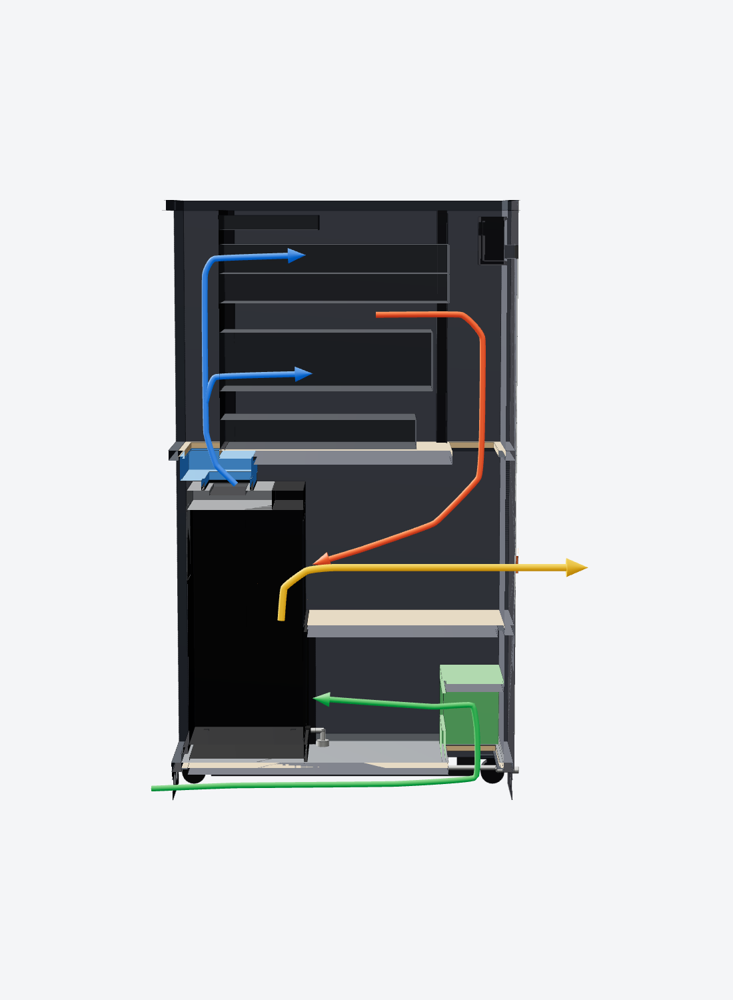
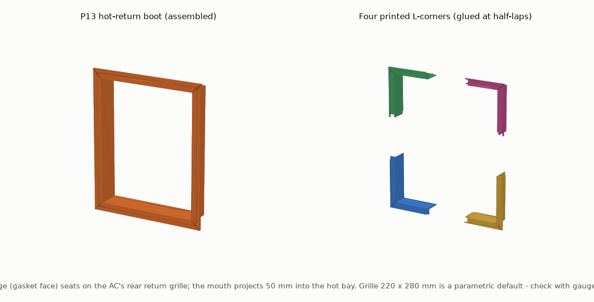

# Rack plenums: the cold supply in and the hot return out, at the AC

The SRA-16 cools the rack in a **sealed air loop**. Two things carry the air between the AC and the rack
across the divider shelf:

| | Printed part | What it does |
|---|---|---|
| **Cold supply — air *into* the rack** | **Cold-air hood + drop collar (P1 / P2 / P3)**, PETG | Caps the AC's top cold louvres and ducts the cold air up through the shelf into the **front plenum**. This *is* the enclosed cold duct — it was already in the print pack. |
| **Hot return — air *out* of the rack** | **Hot-return boot (P13)**, PETG | **New.** Caps the AC's rear return (evaporator) grille and seals it to the **rear plenum**, so the hot server air is positively ducted back into the AC instead of swirling in the bay. |

> **The plenums themselves are not printed.** The front (cold, 130 mm) and rear (hot, 174 mm) plenums are the
> full-height air spaces in front of and behind the servers. Their walls are the cabinet's acoustic lining, the
> divider shelf and the docking gaskets — the rear one alone is about 0.5 m across. They are formed by the
> cabinet, not by plastic. The two printed parts above are the **transition ducts at the AC**, where the air
> actually crosses between the AC and the rack. The exhaust (condenser) side is separate — that's the printed
> elbow and wall spigot (P4 / P5), see `docs/PRINTED_PARTS.md`.



## The hot-return boot (P13)



A rectangular flanged shroud, printed in PETG (return air is only about 35 °C, well within PETG). The flange
seats on the AC's rear face over a 10 mm EPDM gasket and frames the return grille; the mouth projects 50 mm into
the rear plenum. It is split into **four L-corners** for the Bambu Lab X1 Carbon bed, glued at half-lap joints,
about **370 g and 10 h** total.

### The AC return grille is a parametric default — check it first

The Dimplex GDC14RBA draws its return (room-side) air through a grille on its **upper back**, but the exact size
and position aren't published, so the boot is built to a **default you verify**, not a measured grille:

| Parameter (`rack_layout.py`) | Default | Meaning |
|---|---|---|
| `ac_ret_w` | 220 mm | grille width |
| `ac_ret_h` | 280 mm | grille height |
| `ac_ret_dx` | −106 mm | grille centre from the AC centre line (−ve = left) |
| `ac_ret_z` | 727 mm | grille centre above the floor |

The default sits in the **clear left half** of the AC's rear face, on purpose: the rear-**right** of this unit is
taken up by the condenser exhaust (the notch and the insulated elbow), so a centred grille would clash with it.
The model checks that the boot clears the exhaust and the partition and stays on the AC's upper-rear zone.

**Before you print the boot, print gauge G4** (a flat corner template, 10 min). Hold its inner corner on your
AC's actual return grille: the two legs should run along the grille edges. If they don't, measure your grille and
set the four parameters above, then regenerate:

```
python3 tools/make_print_pack.py   # re-exports the boot STLs to the new grille
```

## Installing

1. **Gauge first.** Print **G4** and offer it to the AC's rear return grille. Adjust `ac_ret_*` and regenerate if
   it doesn't line up. Only then print the four boot corners (P13-11, P13-12, P13-21, P13-22).
2. **Glue up.** Bond the four corners at their half-laps into one frame (epoxy or PETG-rated CA). It's a shallow
   box — the laps self-register.
3. **Gasket.** Cut the 10 mm EPDM gasket (model part *Return boot gasket*) to the flange outline and stick it to
   the flange's front (gasket) face.
4. **Mount.** The boot fixes to the **docking frame**, not the AC (the AC rolls out). Fold two small L-brackets
   (1.6 mm steel or alu) and screw them from the four flange corner holes to the dock posts, so the boot stays put
   and the gasket presses onto the AC's rear face when the AC is docked and clamped.
5. **Check the seal.** With the AC docked, the flange gasket should squeeze onto the grille surround all round. Run
   a smoke-pencil check at the flange edge — no draw-through around the outside of the grille.

## Why bother, if it already worked without it

Without the boot, the return simply drops down the rear bay into the AC's grille — it works, but some hot air can
short-circuit around the grille edges and recirculate. The boot makes the return a defined duct, which keeps the
loop tighter and the AC seeing a true return temperature. It's the matching partner to the cold hood, so both
sides of the AC are now sealed printed ducts.

These lines are in `bom/BOM.md`, `bom/printed_parts.csv` (pieces P13-11…P13-22, gauge G4) and the complete
assembly `cad/exports/SRA16_complete_assembly.step`.
